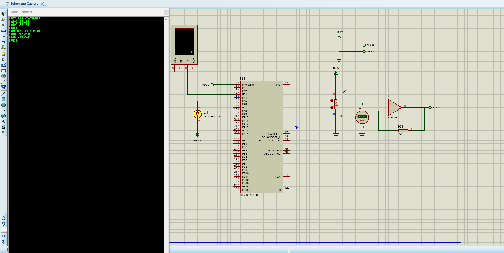

# STM32F103 UART FSM Command Parser & Telemetry Protocol

Event-driven UART communication and command parsing system implemented on **STM32F103C6**, utilizing dual Finite State Machines (FSM) and non-blocking software timers via `TIM2`.

## 1. System Overview
The firmware receives asynchronous ASCII command frames via `USART2` interrupt (`HAL_UART_RxCpltCallback`), validates frame boundaries (`!` start delimiter and `#` end delimiter), reads a 12-bit analog voltage value from `ADC1`, and manages reliable packet transmission with acknowledgment (`!OK#`) and automatic re-transmission timeout.

### Communication Protocol
| Host Command (Virtual Terminal) | MCU Response | Behavior |
| :--- | :--- | :--- |
| `!RST#` | `!ADC=xxxx#` | Samples `ADC1` (12-bit resolution, 0–4095) and transmits formatted telemetry packet. |
| *(No response within 3s)* | `!ADC=xxxx#` | Re-transmits the cached ADC packet every `3000 ms` until acknowledged. |
| `!OK#` | *(Idle)* | Terminates the re-transmission loop and returns communication FSM to `WAIT_RST`. |

## 2. Hardware & Toolchain
* **Microcontroller:** STM32F103C6 (ARM Cortex-M3)
* **Peripherals:** `USART2` (9600 bps, 8N1, RX Interrupt), `ADC1` (12-bit single conversion), `TIM2` (10 ms base interrupt for software timer), `GPIO` (PA5 heartbeat LED)
* **IDE & Configurator:** STM32CubeIDE / STM32CubeMX (HAL Library)
* **Simulation:** Proteus 8 Professional (Virtual Terminal + Analog Potentiometer)

## 3. Firmware Architecture
* **`command_parser_fsm`:** Decodes incoming byte streams from a circular/index buffer, filtering noise outside `! ... #` delimiters to prevent buffer overflow or malformed triggers.
* **`uart_communication_fsm`:** Decouples protocol state management (`WAIT_RST`, `SEND_ADC`, `WAIT_OK`) from interrupt context.
* **Non-blocking Software Timer (`timer.c/.h`):** Driven by `TIM2` hardware interrupt to handle the 3-second ACK timeout and 500 ms LED heartbeat without blocking CPU execution (`HAL_Delay` eliminated).

## 4. Simulation Demo

